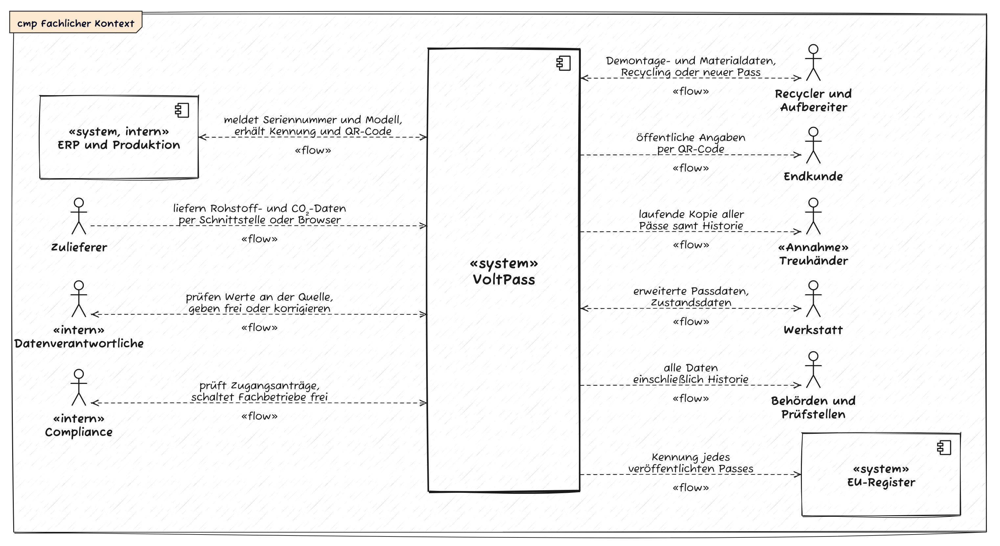

# 3. Kontextabgrenzung

<!-- arc42-Hilfe:
Grenzt das System gegen alle Kommunikationspartner (Nachbarsysteme und Benutzerrollen) ab und legt damit die
externen Schnittstellen und die Verantwortung (Scope) fest. Fachlichen und technischen Kontext unterscheiden.
Mehr: https://docs.arc42.org/section-3/
-->

## 3.1 Fachlicher Kontext

{width=88%}

| ID | Partner | Beschreibung |
|---|---|---|
| P-01 | ERP und Produktion *Fremdsystem* | System von VoltCell. Meldet Seriennummer und Modell jeder gefertigten Batterie und erhält Kennung und QR-Code für den Etikettendruck. |
| P-02 | Datenverantwortliche *Benutzer* | Mitarbeitende von VoltCell. Prüfen jeden Wert an seiner Quelle, geben ihn frei, korrigieren ihn oder fragen beim Zulieferer nach. |
| P-03 | Compliance *Benutzer* | Abteilung von VoltCell. Prüft Zugangsanträge von Fachbetrieben und schaltet sie frei. |
| P-04 | Zulieferer *Benutzer, Fremdsystem* | Liefern Rohstoff- und CO₂-Angaben, mit eigener IT per Schnittstelle, ohne eigene IT per Browser. |
| P-05 | Endkunde *Benutzer* | Ruft per QR-Code ohne Anmeldung die öffentlichen Angaben ab. |
| P-06 | Werkstatt *Benutzer* | Liest nach Freischaltung erweiterte Passdaten und trägt Zustandsdaten wie den State of Health nach. |
| P-07 | Recycler und Aufbereiter *Benutzer* | Lesen Demontage- und Materialdaten, melden Recycling oder bei Umnutzung den neuen Pass an VoltPass. |
| P-08 | Behörden und Prüfstellen *Benutzer, Fremdsystem* | Marktaufsicht, notifizierte Stellen und EU-Kommission sehen alle Daten einschließlich Historie. |
| P-09 | EU-Register *Fremdsystem* | Gesetzlich vorgeschrieben. Erhält die Kennung jedes veröffentlichten Passes. |
| P-10 | Treuhänder *Fremdsystem* | Angenommener unabhängiger Dritter, der bei Wegfall von VoltCell übernimmt. Erhält laufend alle Pässe samt Historie. |

## 3.2 Technischer Kontext {.neue-seite}

| ID | Schnittstelle | Partner | Protokoll und Format | Port | Authentifizierung |
|---|---|---|---|---|---|
| S1 | Weboberfläche | P-02, P-03, P-04, P-06, P-07, P-08 | HTTPS *HTML* | 443 | Intern Firmenkonto über S7, extern VoltPass-Konto |
| S2 | Öffentlicher Passabruf | P-05 | HTTPS *HTML* *JSON-LD* | 443 | Keine, nur öffentliche Angaben |
| S3 | REST-API | P-01, P-04, P-08 | REST über HTTPS *JSON* *JSON-LD* | 443 | Eigener API-Schlüssel je System |
| S4 | EU-Register | P-09 | REST über HTTPS *JSON* | 443 | Wie vom Register vorgegeben |
| S5 | Treuhand-Export | P-10 | SFTP *signiertes JSON-LD* | 22 | Schlüsselpaar |
| S6 | KI-Extraktion | KI-Dienst in der EU | HTTPS *JSON* | 443 | API-Schlüssel von VoltPass |
| S7 | Firmen-Login | Firmen-Login VoltCell | OpenID Connect über HTTPS *JWT* | 443 | VoltPass als registrierte Anwendung |
