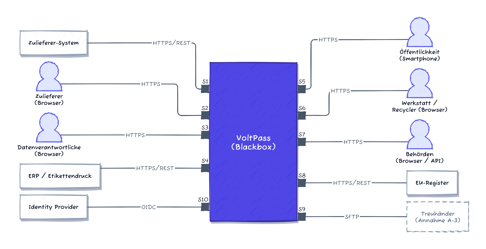

# 3. Kontextabgrenzung

> **Status: Entwurf v0.1.** Protokolle und Ports in 3.2 sind vorläufig und hängen von den Entscheidungen in Kap. 4 und 9 ab.

<!-- arc42-Hilfe:
Grenzt das System gegen alle Kommunikationspartner (Nachbarsysteme und Benutzerrollen) ab und legt damit die
externen Schnittstellen und die Verantwortung (Scope) fest. Fachlichen und technischen Kontext unterscheiden.
Mehr: https://docs.arc42.org/section-3/
-->

VoltPass ist hier eine **Blackbox**. Gezeigt wird nur, mit wem das System Daten austauscht und welche Daten das sind.

**Im Scope:** Daten einsammeln, extrahieren, prüfen, freigeben, als Pass speichern und rollenbasiert ausliefern.

**Nicht im Scope:** Erhebung der Daten bei den Zulieferern selbst, Fertigung und Etikettendruck (ERP), Betrieb des EU-Registers und Ermittlung des Batteriezustands (das macht die Werkstatt).

## 3.1 Fachlicher Kontext

| ID | Kommunikationspartner | Eingabe an VoltPass | Ausgabe von VoltPass |
|---|---|---|---|
| P-01 | Zulieferer mit eigener IT (SH-07) | Rohstoff-, Material- und CO₂-Daten als strukturierte Daten | Bestätigung, Rückfragen zu fehlenden Angaben |
| P-02 | Zulieferer ohne eigene IT (SH-08) | Datenblätter (PDF, CSV), Formulareingaben | Bestätigung, Rückfragen |
| P-03 | Datenverantwortliche VoltCell (SH-03) | Korrekturen, Freigaben | Prüfaufgaben mit extrahierten Werten, Fundstelle und Sicherheit |
| P-04 | ERP / Produktion VoltCell (SH-05) | Seriennummer und Modell jeder gefertigten Batterie | Kennung und QR-Code für den Etikettendruck |
| P-05 | Öffentlichkeit (SH-09) | Abruf über QR-Code | Öffentliche Passdaten (Anhang XIII Nr. 1) |
| P-06 | Werkstatt (SH-10) | Zustandsdaten (State of Health) | Erweiterte Daten für Reparatur und Bewertung |
| P-07 | Recycler (SH-11) | Status „recycelt“ | Demontage- und Materialdaten |
| P-08 | Behörden (SH-12) | Abruf, Prüfanfragen | Alle Passdaten inkl. Änderungshistorie |
| P-09 | EU-Register | – | Kennung jedes Passes |
| P-10 | Treuhänder (SH-13, Annahme A-3) | – | Vollständige Kopie aller Pässe in offenem Format |

## 3.2 Technischer Kontext

Die nummerierten Kästchen an der Systemgrenze markieren die Schnittstellen S1 bis S10. Die Tabelle beschreibt sie im Detail.

| Schnittstelle | Partner | Fachlich (Kap. 3.1) | Kanal / Protokoll | Format | Port | Authentifizierung |
|---|---|---|---|---|---|---|
| S1 | Zulieferer-System | P-01 | HTTPS, REST-API | JSON | 443 | API-Schlüssel je Zulieferer |
| S2 | Zulieferer (Browser) | P-02 | HTTPS, Web-Oberfläche | PDF, CSV, Formular | 443 | Konto (über S10) |
| S3 | Datenverantwortliche (Browser) | P-03 | HTTPS, Web-Oberfläche | HTML | 443 | Konto (über S10) |
| S4 | ERP / Etikettendruck | P-04 | HTTPS, REST-API | JSON | 443 | Technisches Konto |
| S5 | Öffentlichkeit (Smartphone) | P-05 | HTTPS, Aufruf der QR-Adresse | HTML, JSON-LD | 443 | keine |
| S6 | Werkstatt / Recycler (Browser) | P-06, P-07 | HTTPS, Web-Oberfläche | HTML | 443 | Konto (über S10), Annahme A-6 |
| S7 | Behörden (Browser / API) | P-08 | HTTPS, Web-Oberfläche und REST-API | HTML, JSON | 443 | Konto (über S10) |
| S8 | EU-Register | P-09 | HTTPS, REST-API (Annahme) | JSON | 443 | wird vom Register vorgegeben |
| S9 | Treuhänder | P-10 | SFTP, regelmäßiger Export | JSON-LD, signiert | 22 | Schlüsselpaar |
| S10 | Identity Provider | – (technisch) | OpenID Connect über HTTPS | JWT | 443 | – |
