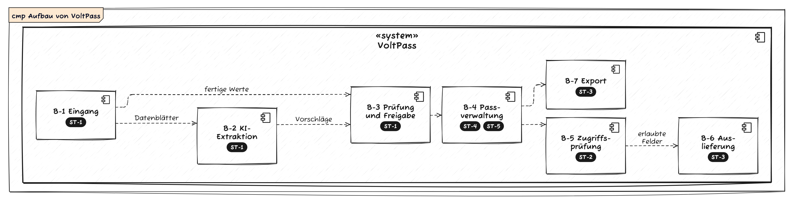

# 4. Lösungsstrategie

<!-- arc42-Hilfe:
Kurzer Überblick über die grundlegenden Entscheidungen und Lösungsansätze: Technologie, Top-Level-Zerlegung,
Ansätze zur Erreichung der wichtigsten Qualitätsziele, organisatorische Entscheidungen.
KURZ zusammenfassen und auf Folgekapitel verweisen.
Mehr: https://docs.arc42.org/section-4/
Aufbau nach dem Beispiel des Dozenten (Vorlesung 19.11.2026): Strategien zu den Kernproblemen aus 1.1.
Alter Entwurf v0.1: docs/archiv/kap4_entwurf_v0.1.md
-->

## 4.1 Lösungsansätze zu den Kernproblemen

Die folgende Tabelle stellt den Kernproblemen aus der Aufgabenstellung die Lösungsstrategien gegenüber, mit Bezug zu den Qualitätszielen.

| ID | Strategie | Ergebnis | Kernproblem | Qualitätsziele |
|---|---|---|---|---|
| ST-1 | **Kein Wert ohne Freigabe** • Alle Eingänge liefern in ein gemeinsames Datenmodell • Die KI liest Datenblätter aus • Ein Mensch prüft jeden Wert und gibt ihn frei | • Kein ungeprüfter Wert im Pass • Liefert ein Zulieferer in einem neuen Format, muss nur der Eingang erweitert werden | H-1 *Unzuverlässige Zulieferdaten* | QZ-1 *Verlässliche Passdaten* QZ-5 *Änderbarkeit* |
| ST-2 | **Zugriff je Feld, an einer Stelle geprüft** • Jedes Passfeld ist einer der drei Zugriffsstufen zugeordnet • Jeder Abruf läuft durch dieselbe Prüfung, die nicht erlaubte Felder entfernt | • Jede Rolle sieht nur ihre Felder • Ändert sich, wer was sehen darf, wird nur die Zuordnung angepasst | H-2 *Gestufter Zugriff* | QZ-3 *Rollengerechter Zugriff* QZ-5 *Änderbarkeit* |
| ST-3 | **Stabile Adresse und Treuhand-Kopie** • Der QR-Code zeigt auf eine eigene, übertragbare Pass-Domain • Der Treuhänder erhält laufend eine signierte Kopie | • QR-Code bleibt gültig • Pässe sind auch ohne VoltPass abrufbar | H-3 *Langlebiger QR-Code* | QZ-2 *Langfristige Erreichbarkeit* |
| ST-4 | **Versionieren statt überschreiben** • Jede Änderung ist eine neue Version • Personen stehen nur als Kennung in der Historie | • Frühere Stände bleiben einsehbar • Ein Name lässt sich löschen, ohne die Historie zu ändern | H-4 *Nachweis trotz Datenschutz* | QZ-4 *Lückenlose Nachweisbarkeit* |
| ST-5 | **Pässe aus Datenblättern ableiten** • Pässe verweisen auf Datenblätter, statt Werte zu kopieren • Eine neue Freigabe aktualisiert alle betroffenen Pässe | • Kein Pass bleibt mit falschen Daten zurück • Der Prüfaufwand bleibt bei 200.000 Pässen pro Jahr machbar | H-5 *Massenhafte Korrekturen* | QZ-1 *Verlässliche Passdaten* QZ-4 *Lückenlose Nachweisbarkeit* |

## 4.2 Technologieentscheidungen {.neue-seite}

| ID | Entscheidung | Begründung | Bezug |
|---|---|---|---|
| TE-1 | AWS in Frankfurt als Zielbetrieb | Im Produktivbetrieb läuft VoltPass in der AWS-Region Frankfurt. Die Daten verlassen die EU nicht. | TR-9, OR-4 |
| TE-2 | KI über Amazon Bedrock | Ein Sprachmodell über Amazon Bedrock in der EU liest die Datenblätter aus. VoltPass ruft es über eine eigene Schnittstelle auf, damit der Dienst austauschbar bleibt. | F-02, S6, QZ-5 |
| TE-3 | Weboberfläche mit React | Alle Menschen arbeiten im Browser, eine Installation ist nicht nötig. Die Oberfläche entsteht mit React und Next.js. | TR-7, F-03, S1 |
| TE-4 | Server mit TypeScript und NestJS | Oberfläche und Server nutzen dieselbe Sprache. NestJS gliedert den Server in Module, die den späteren Bausteinen entsprechen. | TR-9, OR-6 |
| TE-5 | PostgreSQL als Datenbank | Verbreitet, Open Source und für JSON geeignet. Damit lassen sich die Versionen und die Historie aus ST-4 sicher speichern. Im Prototyp läuft sie als Container, im Zielbetrieb als verwalteter Dienst von AWS. | TR-3, F-08, ST-4 |
| TE-6 | JSON-LD als Passformat | Pässe werden maschinenlesbar und ohne Anbieterbindung ausgeliefert und an den Treuhänder exportiert. | TR-3, F-05, S2, S3, S5 |
| TE-7 | Prototyp lokal in Containern | Der Prototyp läuft mit Docker Compose lokal, nur die KI wird über einen API-Schlüssel bei Amazon Bedrock aufgerufen. Weil Dateien über eine eigene Speicher-Schnittstelle abgelegt und Einstellungen nur über Umgebungsvariablen gesetzt werden, laufen dieselben Container später auf AWS. | TR-10, OR-6, OR-9 |

## 4.3 Der Aufbau von VoltPass

VoltPass ist ein modularer Monolith: eine einzige Anwendung, intern in klar getrennte Module gegliedert. Microservices wären für ein kleines Team im Betrieb zu aufwendig, die klaren Modulgrenzen erlauben aber, einzelne Module später abzuspalten.

Die Pfeile zeigen den Datenfluss: Nur Datenblätter durchlaufen die KI-Extraktion, während Daten aus Schnittstellen und Formularen direkt zur Prüfung gelangen. Die Marker ordnen die Strategien aus 4.1 den jeweiligen Bausteinen zu.

Die Module sprechen nur über eigene Schnittstellen miteinander, NestJS setzt sie per Dependency Injection zusammen. So lassen sich etwa der KI-Dienst oder der Dateispeicher austauschen und jedes Modul einzeln testen. Die Bausteine folgen den Prinzipien hohe Kohäsion und lose Kopplung: Jeder hat genau eine fachliche Aufgabe und hängt möglichst wenig von den anderen ab. Der Weg vom Eingang bis zur Passverwaltung ist an das Muster Pipes and Filters angelehnt.

| ID | Baustein | Aufgabe |
|---|---|---|
| B-1 | Eingang | Nimmt Daten aus Schnittstelle, Upload und Formular an und bringt sie in das gemeinsame Datenmodell. |
| B-2 | KI-Extraktion | Schickt Datenblätter an Amazon Bedrock und speichert die zurückgelieferten Werte als Vorschläge. |
| B-3 | Prüfung und Freigabe | Datenverantwortliche prüfen jeden Wert an seiner Quelle, geben ihn frei, korrigieren ihn oder fragen nach. |
| B-4 | Passverwaltung | Vergibt Kennung und QR-Code, verwaltet Pässe, ihre Versionen und die Verweise auf Datenblätter. |
| B-5 | Zugriffsprüfung | Prüft jeden Abruf nach Rolle und Freischaltung und entfernt nicht erlaubte Felder. |
| B-6 | Auslieferung | Stellt freigegebene Pässe über die Passadresse aus dem QR-Code, die Weboberfläche und die REST-API bereit. |
| B-7 | Export | Überträgt alle Pässe samt Historie an den Treuhänder und meldet jeden veröffentlichten Pass an das EU-Register. |

Die Bausteinsicht in Kapitel 5 beschreibt die Bausteine im Detail.

## 4.4 Organisatorische Entscheidungen

| ID | Entscheidung | Beschreibung | Bezug |
|---|---|---|---|
| OE-1 | Prototyp zeigt einen kompletten Ablauf | Ein Datenblatt wird hochgeladen, die KI liest es aus, und ein Mensch prüft und gibt die Werte frei. Danach ist der Pass per QR-Code öffentlich und für eine angemeldete Rolle abrufbar. | F-01, F-02, F-03, F-05, OR-9 |
| OE-2 | Fremdsysteme im Prototyp simuliert | ERP, EU-Register und Treuhänder werden im Prototyp nicht real angebunden. Stattdessen antworten Platzhalter, die VoltPass genauso aufruft wie später die echten Systeme. | TR-8, OR-6 |
| OE-3 | Wesentliche Entscheidungen als ADR | Die wesentlichen Entscheidungen aus 4.2 und 4.3 werden in Kapitel 9 mit Kontext, Alternativen, Begründung und Konsequenzen dokumentiert. | KV-5 |
