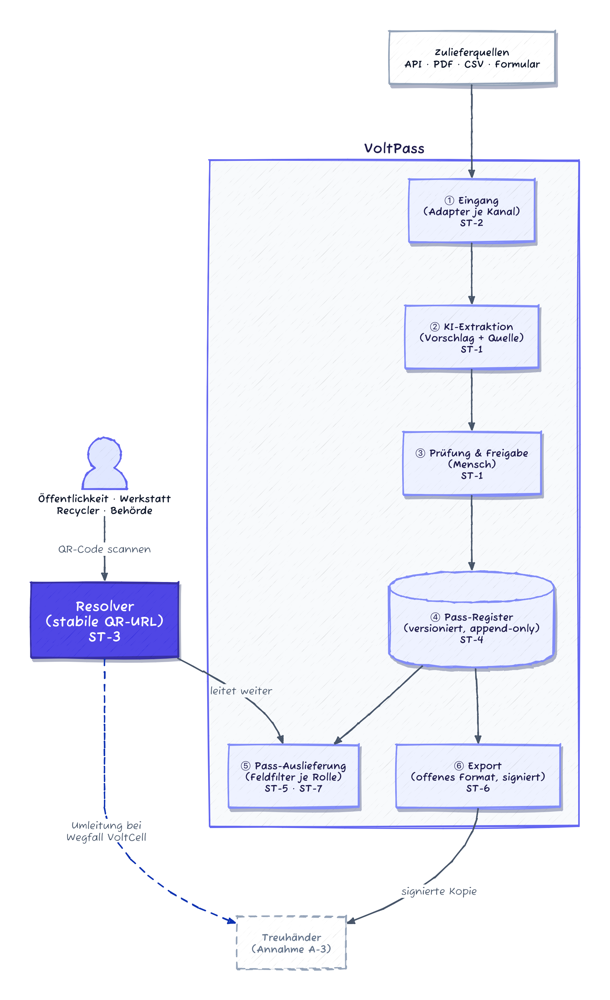

# 4. Lösungsstrategie

> **Status: Entwurf v0.1.** Technologieentscheidungen werden als ADR in Kap. 9 begründet.

<!-- arc42-Hilfe:
Kurzer Überblick über die grundlegenden Entscheidungen und Lösungsansätze: Technologie, Top-Level-Zerlegung,
Ansätze zur Erreichung der wichtigsten Qualitätsziele, organisatorische Entscheidungen.
KURZ zusammenfassen und auf Folgekapitel verweisen.
Mehr: https://docs.arc42.org/section-4/
-->

Die Strategie geht von drei Grundideen aus. Erstens geben **Menschen frei, nicht die KI**. Zweitens werden Daten **nie überschrieben, nur ergänzt**. Drittens gehört **die Adresse im QR-Code nicht zum Server**, auf dem der Pass liegt.

## 4.1 Strategien

| ID | Strategie | Beschreibung | Bedient |
|---|---|---|---|
| ST-1 | **Freigabe-Pipeline mit Mensch** | Daten durchlaufen feste Stufen: Eingang → Extraktion → Prüfung → Freigabe → Pass (Muster *Pipes and Filters*). Die KI liefert nur Vorschläge mit Fundstelle und Sicherheit, veröffentlicht wird erst nach menschlicher Freigabe. | F-02, F-03, QZ-1 |
| ST-2 | **Ein Eingang, viele Adapter** | Jeder Eingangskanal (API, Datei, Formular) hat einen eigenen Adapter. Alle Adapter liefern dasselbe einheitliche Pass-Datenmodell (Muster *Adapter*). Neue Formate brauchen nur einen neuen Adapter. | F-01, TR-5, TR-6, QZ-5 |
| ST-3 | **Stabile Adresse über einen Resolver** | Der QR-Code enthält nur eine dauerhafte Adresse auf eine eigene Domain mit der Kennung. Ein schlanker Resolver leitet von dort zum aktuellen Speicherort weiter. Fällt VoltCell weg, wird nur die Weiterleitung auf den Treuhänder umgestellt, der Code bleibt gültig. | F-05, F-08, TR-1, TR-2, QZ-2 |
| ST-4 | **Versionieren statt überschreiben** | Jede Änderung erzeugt eine neue, unveränderliche Version mit Wer, Wann, Quelle und Begründung (append-only). Der aktuelle Pass ist die neueste freigegebene Version. | F-06, F-07, QZ-4, QZ-1 |
| ST-5 | **Feldgenaue Zugriffsregeln an einer Stelle** | Jedes Passfeld wird einer Zugriffsstufe nach Anhang XIII zugeordnet. Eine zentrale Regel filtert bei jedem Abruf die Felder nach Rolle. Ändert die Kommission die Stufen, ändert sich nur diese Zuordnung. | F-05, F-06, OR-2, QZ-3 |
| ST-6 | **Offenes Format und Treuhand-Kopie** | Pässe werden in einem offenen, maschinenlesbaren Format (JSON-LD) gespeichert und regelmäßig signiert an den Treuhänder exportiert. So kann ein Dritter die Pässe ohne VoltPass-Software weiter ausliefern. | F-08, OR-3, OR-5, TR-3, QZ-2, QZ-5 |
| ST-7 | **Lesen und Schreiben trennen** | Freigegebene Pässe werden in einer leseoptimierten Form bereitgestellt, getrennt von der internen Bearbeitung (Muster *CQRS*). Die vielen Abrufe belasten so nicht die Prüfprozesse, und die öffentliche Seite hat keinen Zugang zu unfreigegebenen Daten. | F-05, TR-4, QZ-2, QZ-3 |
| ST-8 | **Browser für alle Menschen** | Alle menschlichen Akteure arbeiten über eine Web-Oberfläche, eine App-Installation ist nicht nötig. Die Anmeldung läuft zentral über einen Identity Provider. | F-01, F-03, F-05, TR-6 |

## 4.2 Abdeckung der Qualitätsziele

| Qualitätsziel | Strategien | Details |
|---|---|---|
| QZ-1 Verlässliche Passdaten | ST-1, ST-4 | Kap. 8 (Datenqualität), ADR folgt |
| QZ-2 Langfristige Erreichbarkeit | ST-3, ST-6, ST-7 | Kap. 7, Kap. 8 (Langzeitverfügbarkeit) |
| QZ-3 Rollengerechter Zugriff | ST-5, ST-7 | Kap. 8 (Sicherheit) |
| QZ-4 Lückenlose Nachweisbarkeit | ST-4 | Kap. 8 (Audit) |
| QZ-5 Interoperabilität | ST-2, ST-6 | Kap. 8 (Datenformat) |

## 4.3 Grobe Zerlegung und Technologie

- **Zerlegung:** Die Bausteine folgen dem Datenfluss im Diagramm oben: ① Eingang, ② Extraktion, ③ Prüfung und Freigabe, ④ Pass-Register, ⑤ Auslieferung und ⑥ Export. Dazu kommt der Resolver, der bewusst getrennt betrieben wird. Die Details folgen in Kap. 5.
- **Technologie:** offen, wird per ADR entschieden. Leitlinien: verbreitete Open-Source-Komponenten (wegen TR-3, QZ-5), Betrieb in der EU (wegen A-5), die KI-Extraktion als austauschbarer Dienst hinter einer eigenen Schnittstelle.
- **Prototyp (Vorschlag, noch nicht entschieden):** F-01 bis F-03 und F-05 als **vertikaler Slice**: Datenblatt hochladen → Werte extrahieren → prüfen und freigeben → Pass über eine stabile Adresse rollenabhängig anzeigen.
